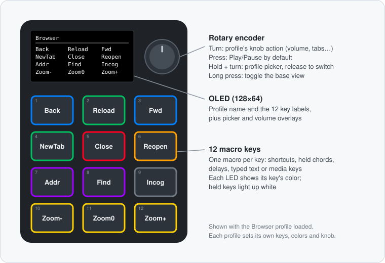

# macropad-profiles

CircuitPython firmware for the [Adafruit MacroPad RP2040](https://www.adafruit.com/product/5128).
It has 12 keys, a rotary encoder with a push switch, 12 NeoPixels and a 128×64
OLED. The firmware gives the pad per-app key profiles, encoder gestures and an
OLED UI, and it works as a plain USB keyboard and media controller. No host
software is needed.

<p align="center">
  
</p>

## Features

- **Profiles:** one file per app in `firmware/profiles/`. Each file sets 12
  keys (color, label, action), what the knob and its press do, and an LED mode.
  The pad ships with Spotify, Default, Traktor (placeholder bindings), Windows,
  Browser and Discord.
- **Encoder gestures:**

  | Gesture | Action |
  | --- | --- |
  | Turn | Profile's knob action (system volume by default) |
  | Press | Profile's press action (Play/Pause by default) |
  | Hold + turn | Open the profile picker; release to switch |
  | Long press (≥ 600 ms) | Reserved for switching views (only the keymap view exists so far) |

- **Macros:** key sequences, chords held for as long as you hold the key (for
  example, push-to-talk), delays, typed text and media keys. They run without
  blocking, so a delay in one key never stalls another.
- **OLED:** shows the profile name and key labels, with overlays for the
  picker and volume changes.
- **Extra OLEDs (optional):** an SSD1306 128×64 panel on the STEMMA QT port, or
  several behind a PCA9548A I²C mux (one per channel). Each
  shows the profile name, plus ripples from each key press, a wave that
  follows the knob, and drifting stars when idle. Without it, the pad runs as
  usual.
- **LEDs:** static per-key colors or a rainbow cycle. Held keys light up white.
- The last-used profile is restored after a reset.

## Requirements

- An Adafruit MacroPad RP2040 running CircuitPython 10
- Python 3 on the host, for deploying and running the tests
- [`circup`](https://github.com/adafruit/circup) to install board libraries

## Setup

```powershell
python -m venv .venv
.venv\Scripts\pip install circup -r firmware/tests/requirements.txt -r tools/requirements.txt

# Install board libraries onto the CIRCUITPY drive
.venv\Scripts\circup install -r firmware/requirements.txt

# Copy the firmware to the board (default drive F:\)
.venv\Scripts\python tools\deploy.py --drive F:\

# Watch the board's serial output (--reload restarts code.py first)
.venv\Scripts\python tools\serial_console.py --reload
```

`tools/deploy.py` copies only the files that changed and writes `code.py`
last. It accepts `--dry-run` to preview, and `--prune` to delete stale files
under `ui/`, `profiles/` and `panel/`. Edit the files in `firmware/` and deploy; don't
edit the board drive directly, because every write reloads the board.

## Adding a profile

Add a file to `firmware/profiles/`, for example `60_myapp.py`, and deploy:

```python
from adafruit_hid.keycode import Keycode as K

app = {
    "name": "My App",          # shown in the picker (≤ 21 chars)
    "order": 60,               # sort position in the picker
    "knob": ("keys", [K.CONTROL, K.EQUALS], [K.CONTROL, K.MINUS]),  # or "system_volume"
    "leds": "static",          # or "rainbow"
    "macros": [                # exactly 12: (color, label ≤ 6 chars, action)
        (0x00C060, "Save", [K.CONTROL, K.S]),
        # ...
    ],
}
```

Action items:

| Item | Meaning |
| --- | --- |
| `int ≥ 0` | Press a keycode |
| `int < 0` | Release a keycode |
| `float` | Delay in seconds |
| `str` | Type the text |
| `[[code, ...]]` | Consumer-control (media) codes |

Profiles are data only. A file with invalid content is skipped and a message
is printed to the serial console. A bad profile can't crash the pad.

## Repository layout

```
firmware/            Everything that goes on the board
  code.py            Main loop: input → gestures → actions → LEDs → UI
  hw.py              Hardware setup (keys, encoder, display, HID)
  actions.py         Non-blocking macro runner
  gestures.py        Encoder gesture state machine
  panel/             Second OLED on STEMMA QT (raw SSD1306 driver, canvas, art)
  profile_loader.py  Profile loading, validation, last-used profile
  leds.py            NeoPixel modes
  ui/                OLED views (keymap, picker, volume)
  profiles/          One file per app profile
  tests/             Host-side unit tests
tools/deploy.py      Copies changed firmware files to the board
docs/handoff.md      Full spec and phase plan
PHASE2_PLAN.md       Planned Windows host companion (not built yet)
```

## Tests

The tests cover the pure-logic modules (actions, gestures, profile loading).
They run on CPython with the HID libraries installed and USB stubbed:

```powershell
.venv\Scripts\python -m unittest discover -s firmware/tests
```

## Roadmap

- **Windows host companion (Phase 2):** profiles switch automatically to
  match the focused app, and features such as Spotify's own volume can use the
  host. Until it exists, actions that need the host fall back to plain HID. See
  `PHASE2_PLAN.md`.
- **Audio visualizer on the second OLED:** the Phase 2 host sends spectrum
  bars, and the second panel shows them instead of the idle art.
- **Extra panels over I²C:** other control panels connect through an
  Adafruit PCA9548A 8-channel I²C
  multiplexer, and some profiles will extend onto them. The feature set is
  still being worked out.
