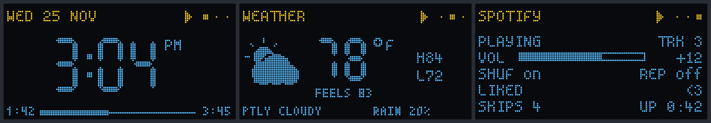
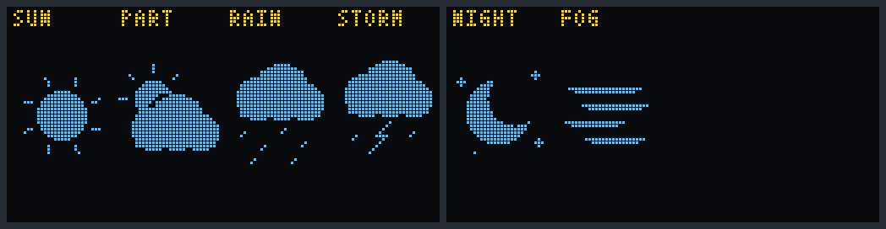

# Proposed next step: real time and weather on the Spotify HUD

Status: **parked** (Ema, 2026-11-25). The HUD views are built and merged in
PR #10, but the clock and weather run on fake data (`DEMO = True` in
`firmware/code.py`). This page is the plan for feeding them real data.

## The design (already built)

The mockups that locked the design, rendered at the panel's real pixels
(128×64, yellow rows 0–15, blue below):

The firmware draws these from `panel/hostdata.py`'s `HostData`: local
time, weather (`code, temp, feels, hi, lo, rain%, is_day`) and the moon
(`cycle 0–255, lit%, rise, set`). Only the source of that data is missing.

## Why the pad can't do it alone

- **No internet.** The weather has to come from somewhere online.
- **No clock that survives power-off.** The MacroPad has no RTC battery,
  and the time is lost on unplug.
- **No answer from Windows.** A USB keyboard never receives the time or
  any other data back from the PC.

## Options

| | Time | Weather | Needs |
|---|---|---|---|
| **A. Small PC sender** (recommended) | ✅ | ✅ | `boot.py`, one unplug/replug, a Python script running on the PC |
| **B. DS3231 RTC on the mux** | ✅ | ❌ | A STEMMA QT RTC breakout + coin cell on a free mux channel |
| **C. ESP32 Wi-Fi co-processor** | ✅ | ✅ | New hardware, Wi-Fi credentials on a device, I²C link to the pad |

A is the cheapest and reuses the port Phase 2 needs anyway
(`PHASE2_PLAN.md`). B can be added later so the clock survives with the
PC off.

## How A would be built (each step ends with a board test)

1. **Second USB channel.** Add `firmware/boot.py` with `usb_midi.disable()`
   and `usb_cdc.enable(console=True, data=True)`.
   - No firmware uses MIDI, so disabling it is safe.
   - Don't call `usb_hid.enable()`: `hw.py` relies on the default HID devices.
   - Endpoint budget on the RP2040: MSC + HID + 2 CDC = 6 of 7.
   - **Test:** unplug and replug. A second COM port appears, there's no
     `>>>` and no safe mode, and the keys still work.
2. **Pad side: `firmware/link.py`.** A non-blocking reader on
   `usb_cdc.data`.
   - It reads only what's waiting on each loop pass and caps lines at
     64 bytes. Malformed lines are dropped.
   - It updates `HostData`, and `DEMO` turns off once the link has data.
   - The protocol is host → pad ASCII lines:
     - `H`: heartbeat. The link counts as alive for 3 s after one.
     - `K <yyyy> <mo> <dd> <hh> <mm> <ss> <wday>`: local time.
     - `W <code> <temp> <feels> <hi> <lo> <rain%> <is_day>`: weather.
     - `M <cycle0-255> <lit%> <rise_min> <set_min>`: moon and sun.
   - Host-side tests cover the parser: junk lines, over-long lines, and
     partial reads.
3. **PC side: `host/hudfeed.py`.**
   - **Port:** find the data COM port by VID/PID plus `MI_xx` in the
     registry, never by COM number. Reconnect after an unplug.
   - **Time:** send `K` on connect and every 10 min. That covers drift,
     DST changes and the pad's lack of a battery.
   - **Weather:** call Open-Meteo every 10 min (no API key) and send `W`:
     `current=temperature_2m,apparent_temperature,weather_code,is_day`,
     `daily=temperature_2m_max,temperature_2m_min,precipitation_probability_max`,
     `temperature_unit=fahrenheit`, `timezone=auto`.
   - **Moon and sun:** copy `moon_phase()` and `sun_times()` from
     `oled-bonnet/oled_hud/hud/sky.py` (stdlib only, works offline) and
     send `M`.
   - **Location:** latitude/longitude live only in
     `%APPDATA%\macropad\config.toml`, never in the repo.
   - Add a `--dry-run` flag that prints the lines instead of sending them.
   - **Test:** run it. The pad shows the real time, the date in the yellow
     band and the real weather. Kill the script and the time keeps running,
     and the weather shows `no link` after 30 min.
4. **Later, the full helper (Phase 2).** Add Spotify's real play state,
   position, title and artist from the Windows media session to the same
   script:
   - `N <0|1> <pos_ms> <dur_ms>`, `T <title>`, `R <artist>`.
   - Extrapolate the position from `LastUpdatedTime`, and transliterate
     titles to ASCII on the host.
   - This retires the long-press play-state flip and makes the tonearm a
     real scrubber.

## Open questions for next session

- Start the script with Windows (Task Scheduler at log-on), or by hand?
- Add B (the RTC) too, so the clock works with the PC off?
